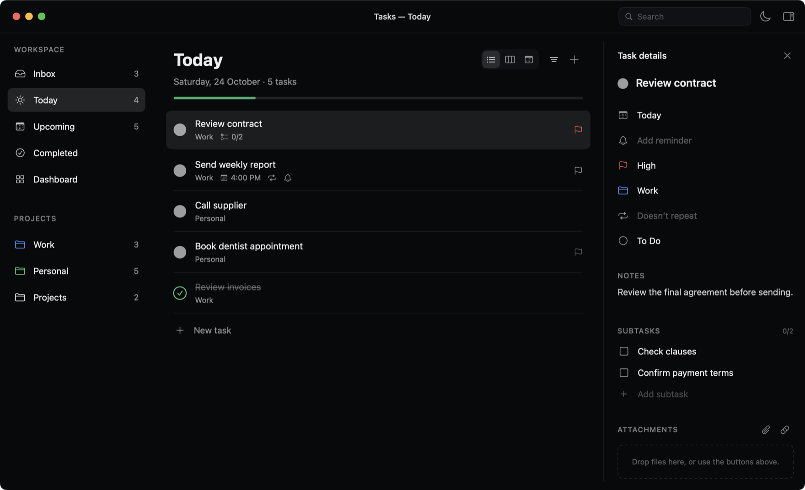
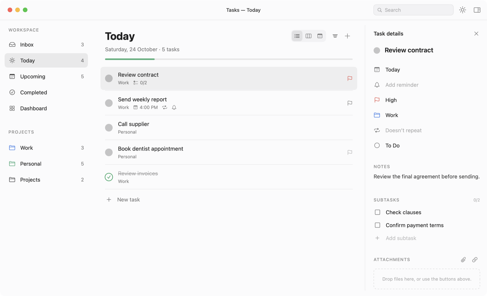
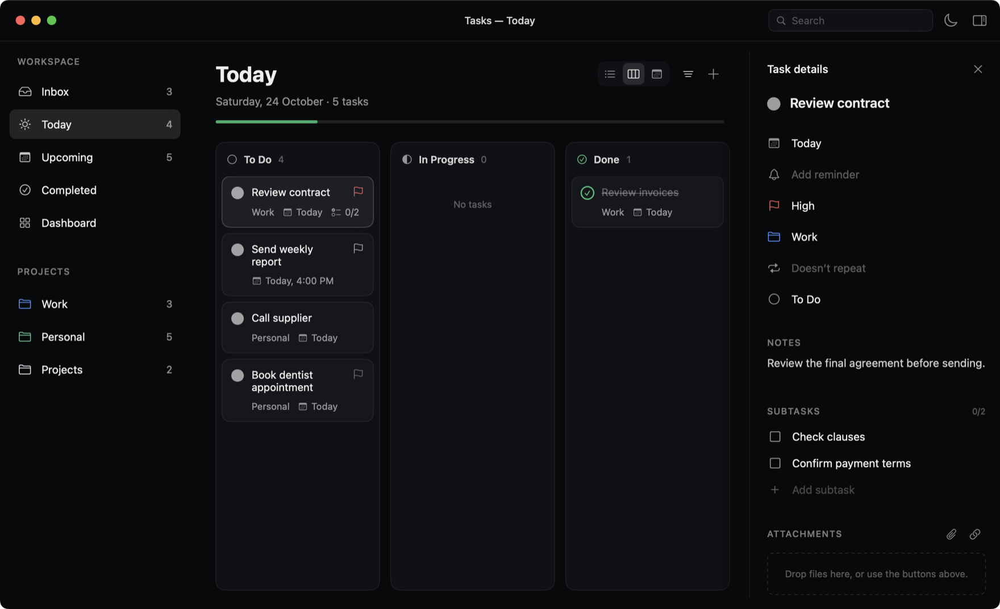
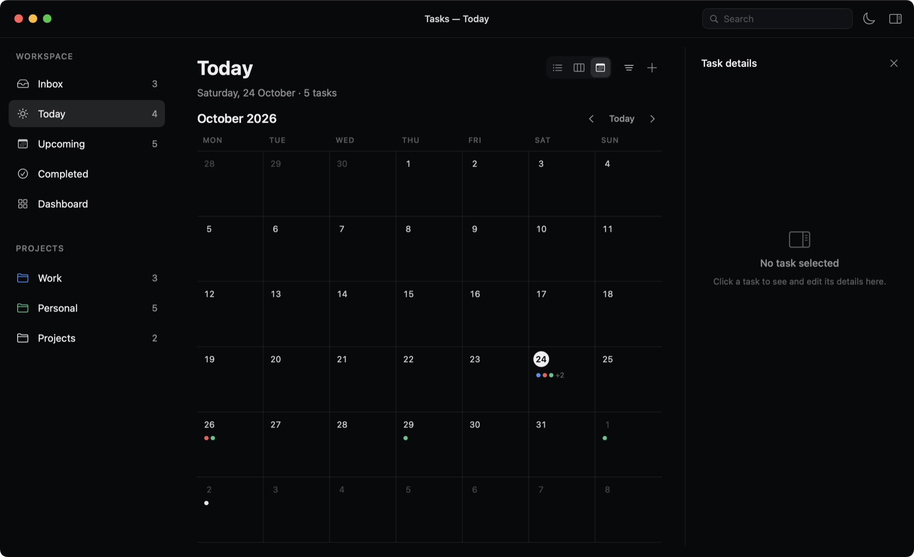
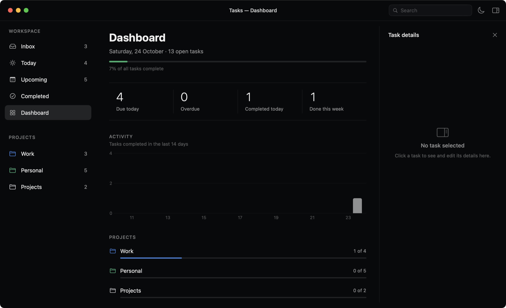
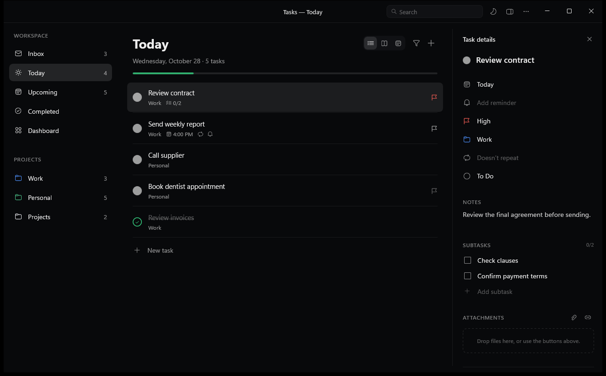
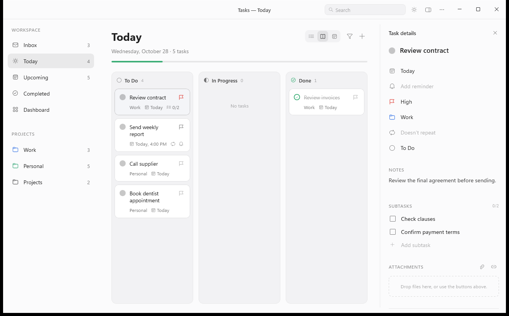

# ToDoApp

A native task manager for macOS (Swift and SwiftUI) and Windows (C# and WinUI 3). Minimal and monochrome on the surface, with projects, recurring tasks, reminders, a board, a calendar and a dashboard underneath.

[](https://github.com/RamazJanashia/ToDoApp/actions/workflows/build.yml)


[](LICENSE)



<p align="center">
  
  
  
  
</p>

## Features

- **Tasks** — create, edit, complete, duplicate and delete, with full undo and redo.
- **Due dates and times** — quick picks (Today, Tomorrow, Next week), a month calendar and an optional time. Overdue tasks turn red.
- **Priorities** — High, Medium and Low. Only High uses colour.
- **Projects** — each with its own name, icon and colour. Deleting a project moves its tasks to the Inbox.
- **Subtasks** — a checklist inside each task, with progress shown on the row.
- **Recurring tasks** — daily, weekdays, weekly, monthly, yearly, or custom (every *n* days, weeks, months or years, on chosen weekdays). Completing one schedules the next; month-end dates stay on the month's last day.
- **Reminders** — native macOS notifications, from "at time of due" to two days before. Clicking a notification opens the task.
- **Attachments** — files, images (with thumbnails) and web links. Drop files straight onto the details panel.
- **Search and filter** — instant search across titles, notes, subtasks, projects and attachments. Sort by manual order, due date, priority, title or creation date; filter by priority.
- **Four views** — List, Board (To Do · In Progress · Done), Calendar (month) and Dashboard.
- **Drag and drop** — reorder the list, or drop tasks on a project, on Today/Upcoming/Completed, on a board column or on a calendar day.
- **Light and dark** — follows macOS, or pin either one from the toolbar, the View menu or Settings.
- **Responsive layout** — side columns give way on small windows; lists keep a readable width on large screens and in full screen.
- **Local and private** — no account, no network. Everything is saved on your Mac.

## Requirements

- macOS 13 Ventura or later
- To build: the Xcode Command Line Tools (`xcode-select --install`) **or** Xcode 15+

## Build and run

```sh
git clone https://github.com/RamazJanashia/ToDoApp.git
cd ToDoApp
./build.sh --run
```

| Command | What it does |
|---|---|
| `./build.sh` | Builds an optimised `build/TodoApp.app` |
| `./build.sh --run` | Builds, then opens the app |
| `./build.sh --install` | Builds, then copies the app to `~/Applications` |
| `./build.sh --check` | Builds the core library and runs its behaviour checks |
| `./build.sh --debug` | Faster, unoptimised build |

`build.sh` calls `swiftc` directly, so it only needs the Command Line Tools. (Some Command Line Tools releases ship a SwiftPM that can't build without full Xcode; the script sidesteps that.) It assembles a proper app bundle with an icon and signs it ad hoc so notifications work.

**With Xcode:** open `Package.swift`, choose the **TodoApp** scheme and press Run. When the app runs from Xcode it isn't inside an app bundle, so reminders are switched off; use `./build.sh --run` to try notifications.

> The app is signed ad hoc, not with an Apple Developer ID. If you copy it to another Mac, Gatekeeper will say the developer can't be verified: right-click the app and choose **Open** the first time.

## Keyboard shortcuts

| Shortcut | Action |
|---|---|
| ⌘N / ⇧⌘N | New task / new project |
| ⌘F | Search (Esc clears) |
| ↑ ↓ | Move through tasks |
| Space or ⌘↩ | Complete or reopen |
| ↩ or ⌘E | Edit the title |
| Double-click | Open a task's details |
| ⌫ or ⌘⌫ | Delete (undoable) |
| ⌘D | Duplicate |
| ⌃⌘3 / 2 / 1 / 0 | Priority High / Medium / Low / None |
| ⌥⌘T / ⇧⌥⌘T | Due today / tomorrow |
| ⌘1 / ⌘2 / ⌘3 | List / Board / Calendar |
| ⌥⌘1 … ⌥⌘5 | Inbox, Today, Upcoming, Completed, Dashboard |
| ⌃⌘S / ⌥⌘I | Show or hide the sidebar / task details |
| ⌘Z / ⇧⌘Z | Undo / redo |

## Where your data lives

Everything stays in `~/Library/Application Support/TodoApp/`:

- `tasks.json` — tasks and projects, saved automatically a moment after each change and when the app quits. Writes are atomic, so a crash can't leave a half-written file.
- `Attachments/` — copies of attached files, so attachments survive the originals being moved or deleted.

If `tasks.json` can't be read, it is set aside as `tasks.unreadable-<time>.json` and never overwritten. To try the app without touching your own tasks, point it at another folder:

```sh
TODOAPP_DATA_DIR=/tmp/todo-sandbox build/TodoApp.app/Contents/MacOS/TodoApp
```

## Windows

The Windows version lives in `windows/`. It is a native WinUI 3 app (C#, .NET 10) with the same features, the same monochrome look and the same `tasks.json` format as the Mac app. It keeps its own data: nothing syncs between the two.

<p align="center">
  
  
</p>

**Requirements:** Windows 10 version 1809 or later, or Windows 11 (x64). To build: the [.NET SDK 10](https://dotnet.microsoft.com/download). No Visual Studio needed.

```powershell
git clone https://github.com/RamazJanashia/ToDoApp.git
cd ToDoApp\windows
.\build.ps1 -Run
```

| Command | What it does |
|---|---|
| `.\build.ps1` | Publishes a self-contained build to `windows\dist\TodoApp\` and zips it as `dist\TodoApp-win-x64.zip` |
| `.\build.ps1 -Run` | Builds a debug version, then starts it |
| `.\build.ps1 -Install` | Publishes, copies the app to `%LOCALAPPDATA%\Programs\TodoApp\` and adds a Start menu shortcut |
| `.\build.ps1 -Check` | Runs the tests |

> The build is not signed. The first time you start it, Windows SmartScreen may say it protected your PC: choose **More info**, then **Run anyway**.

**Keyboard shortcuts** — the same as on the Mac, with Ctrl in place of ⌘:

| Shortcut | Action |
|---|---|
| Ctrl+N / Ctrl+Shift+N | New task / new project |
| Ctrl+F | Search (Esc clears) |
| ↑ ↓ | Move through tasks |
| Space or Ctrl+Enter | Complete or reopen |
| Enter or Ctrl+E | Edit the title |
| Double-click | Open a task's details |
| Delete or Backspace | Delete (undoable) |
| Ctrl+D | Duplicate |
| Ctrl+Shift+3 / 2 / 1 / 0 | Priority High / Medium / Low / None |
| Ctrl+T / Ctrl+Shift+T | Due today / tomorrow |
| Ctrl+1 / 2 / 3 | List / Board / Calendar |
| Alt+1 … Alt+5 | All Tasks, Today, Upcoming, Completed, Dashboard |
| Ctrl+Shift+S / Ctrl+Shift+I | Show or hide the sidebar / task details |
| Ctrl+Z / Ctrl+Y | Undo / redo |
| Ctrl+, | Settings |

The **…** button in the title bar opens the same commands as a menu.

**Projects** can hold sub-projects, which fold away in the sidebar. A project lists and counts its sub-projects' tasks, and its list shows finished tasks below the open ones, one day at a time. Deleting a project moves its tasks and sub-projects up a level. **All Tasks** lists the open tasks from every project.

**Settings** can hide sidebar places, views, parts of task rows and details, dashboard sections and title-bar items; hiding something never changes your tasks. **Customize** at the foot of the sidebar always opens it. The app remembers the open place, the selected task, the filter, the sidebar and folded projects between launches.

**Reminders** are Windows notifications, scheduled with Windows itself, so they appear even when TodoApp is closed. Clicking one opens the task. If notifications are turned off for TodoApp, setting a reminder says so.

**Where your data lives:** everything is in one folder, `%LOCALAPPDATA%\TodoApp\`, so copying it backs up everything:

- `tasks.json`, the tasks and projects, and `settings.json`.
- `Backups\<date>\tasks.json`, your tasks as they stood when that day began. The newest 30 are kept.
- `Attachments\<date>\`, copies of attached files.

A stored file is removed only once nothing can need it: not `tasks.json`, not a backup, and not attached in the last 30 days. If `tasks.json` can't be read, it is set aside as `tasks.unreadable-<time>.json`, and while that file is there no attachments are cleaned up. A file saved by a newer version of the app is left in place, and changes aren't saved over it. Settings ▸ Show Data Folder opens the folder.

To try the app without touching your own tasks or reminders, start it with `--data-dir <folder>` (or set `TODOAPP_DATA_DIR`); reminders stay off there.

The code is in `windows/src/`: `TodoCore` (models, recurrence, queries, persistence; a port of the Swift module), `TodoApp.State` (the store, undo, autosave and what each view shows; no UI) and `TodoApp` (the WinUI shell). Tests are in `windows/tests/`.

## Architecture (macOS)

The code is split into two modules:

- **TodoCore** — plain Foundation, no UI: the models (`TaskItem`, `Project`, `RecurrenceRule`), queries and sorting, list sections, recurrence maths, multi-task operations, dashboard statistics and JSON persistence. It is fully covered by the behaviour checks.
- **TodoApp** — SwiftUI with AppKit where SwiftUI falls short (window chrome, keyboard handling, notifications). `TaskStore` owns the data, undo and autosave; `AppState` owns what the window shows and the actions that span several views.

```
Sources/
  TodoCore/                Models, recurrence, queries, operations, persistence
  TodoApp/
    App/                   Entry point, menu commands, window chrome
    Store/                 TaskStore (data, undo, autosave) · AppState (selection, view)
    Services/              Notifications, attachment storage
    Design/                Theme tokens (light and dark) and shared components
    Views/                 Sidebar · List · Board · Calendar · Dashboard · Inspector
Tests/TodoCoreChecks/      Behaviour checks for TodoCore
Scripts/make_icon.swift    Draws the app icon
build.sh                   Builds and packages the app without Xcode
```

A few decisions worth knowing:

- **JSON instead of SwiftData.** SwiftData needs macOS 14, and this app supports macOS 13. Persistence sits behind one small type (`DataFileStore`), so moving to SwiftData later touches only that and `TaskStore`.
- **Value types throughout.** Tasks and projects are structs, which makes undo a matter of keeping the previous value.
- **Typing has its own undo.** Text fields use the text system's undo; structural undo restores everything else without rolling back what you typed.

## Tests

```sh
./build.sh --check
```

The checks cover recurrence (including month ends and leap days), reopening repeating tasks, queries and sorting, list sections, drag ordering, dashboard numbers, reminder timing and persistence (round trips, older files and unreadable files). They run as a small executable because the Command Line Tools don't include XCTest. CI runs them on every push.

## Contributing

Issues and pull requests are welcome. Before opening a pull request:

1. Run `./build.sh --check` and make sure every check passes.
2. Run `./build.sh` and make sure the app builds without warnings.
3. Keep the visual language: monochrome first, colour only where it carries meaning, and a light and dark value for every colour (see `Design/Theme.swift`).

## License

[MIT](LICENSE) © 2026 Ramaz Janashia
